<p align="center">
  
</p>

<p align="center">
  
  
</p>

<p align="center">
  
  
</p>

<p align="center">
  
</p>

<p align="center">
  
</p>

<p align="center">
  
</p>

<p align="center">
  <a href="https://github.com/soullessness1611?tab=repositories">
    
  </a>
</p>

<p align="center">
  
</p>

---

<details>
<summary><b>⚙️ วิธีทำงานและวิธีตั้งค่า (CyberPunk GitHub Stats)</b></summary>

## มันคืออะไร

การ์ดทั้งหมดด้านบนเป็นไฟล์ SVG ที่สร้างเองด้วย Python (ใช้แค่ standard library ไม่มี dependency)
ดึงข้อมูลจาก GitHub GraphQL API และ WakaTime API แล้วเขียนไฟล์ลง `assets/`
GitHub Actions รันทุก 6 ชั่วโมงแล้ว commit การ์ดใหม่กลับเข้า repo เอง

| การ์ด | ไฟล์ | ข้อมูลที่แสดง |
|---|---|---|
| Header | `header.svg` | ชื่อ, tagline, ปีที่เริ่มใช้ GitHub |
| GitHub Stats | `stats.svg` | ดาว, commit ปีนี้/ทั้งหมด, PR, issue, repo ที่ร่วม contribute, followers |
| Streak | `streak.svg` | streak ปัจจุบัน, streak ยาวที่สุด, contribution ทั้งหมด |
| Top Languages | `languages.svg` | ภาษาที่ใช้มากสุดตามขนาดโค้ดใน repo ของตัวเอง |
| Repositories & Stars | `repos.svg` | จำนวน repo, ดาว, fork และ repo ดาวสูงสุด |
| Contribution Graph | `contributions.svg` | ตาราง contribution 1 ปีล่าสุด |
| Commit Activity | `activity.svg` | ช่วงเวลาที่ commit (ตาม `timezone`), วันในสัปดาห์, 12 เดือนล่าสุด |
| Technology Skills | `skills.svg` | รายการจาก `skills` ใน `config.json` |
| Latest Projects | `projects.svg` | repo ที่ push ล่าสุด (ไม่รวม archived) |
| WakaTime | `wakatime.svg` | เวลาเขียนโค้ด 7 วันล่าสุด (ถ้าไม่ตั้ง key จะขึ้น LINK OFFLINE) |

## ตั้งค่าให้ใช้งาน

1. วางไฟล์ทั้งหมดใน repo ชื่อเดียวกับ username (`soullessness1611/soullessness1611`) เพื่อให้ README ขึ้นหน้าโปรไฟล์
2. แก้ `config.json` ตามต้องการ:

   | key | ความหมาย |
   |---|---|
   | `username` | GitHub username ที่จะดึงข้อมูล |
   | `display_name`, `tagline` | ข้อความบน header |
   | `timezone` | โซนเวลาสำหรับกราฟ commit activity (เช่น `Asia/Bangkok`) |
   | `include_private_repos` | `true` = นับ repo private ด้วย (ต้องใช้ `GH_PAT`) |
   | `exclude_repos`, `exclude_languages` | repo / ภาษาที่ไม่ต้องนับ |
   | `top_languages_count`, `latest_projects_count` | จำนวนรายการบนการ์ด |
   | `commit_activity_repo_limit` | จำนวน repo ที่ใช้สุ่มเวลา commit |
   | `skills` | หมวด → รายการ skill บนการ์ด Technology Skills |

3. ตั้ง secret ใน **Settings → Secrets and variables → Actions** (ไม่บังคับ):
   - `GH_PAT` — classic token scope `read:user` (+ `repo` ถ้าอยากนับ private) ไม่ตั้งก็ได้ จะใช้ `GITHUB_TOKEN` ของ workflow ซึ่งเห็นแค่ข้อมูล public
   - `WAKATIME_API_KEY` — จาก <https://wakatime.com/settings/api-key>
4. ไปที่แท็บ **Actions → Update CyberPunk stats → Run workflow** เพื่อสร้างการ์ดครั้งแรก

## รันบนเครื่อง (Python 3.10+)

```bash
# ดูหน้าตาการ์ดด้วยข้อมูลตัวอย่าง ไม่ต้องใช้ token
python -m generator --demo

# ใช้ข้อมูลจริง
GH_TOKEN=$(gh auth token) WAKATIME_API_KEY=xxx python -m generator

# รันเทสต์
python -m unittest discover -s tests -t .
```

ตัวเลือก: `--out <dir>` (ค่าเริ่มต้น `assets`), `--config <file>` (ค่าเริ่มต้น `config.json`)

## โครงสร้างไฟล์

```
generator/
  __main__.py    จุดเริ่ม: อ่าน config → ดึงข้อมูล → เขียน SVG
  github_api.py  GraphQL client + query โปรไฟล์ / contribution รายปี / เวลา commit
  wakatime.py    ดึงสถิติ 7 วันจาก WakaTime
  stats.py       คำนวณ streak, ภาษา, activity (pure functions)
  cards.py       วาดการ์ด SVG ทั้ง 10 ใบ
  theme.py       สี, ฟอนต์, กรอบ และ animation ธีม CyberPunk
  demo.py        ข้อมูลตัวอย่างสำหรับ --demo
tests/           unittest ของ stats และการ์ด
assets/          SVG ที่สร้างแล้ว (workflow เขียนทับ)
.github/workflows/update-stats.yml
```

</details>
